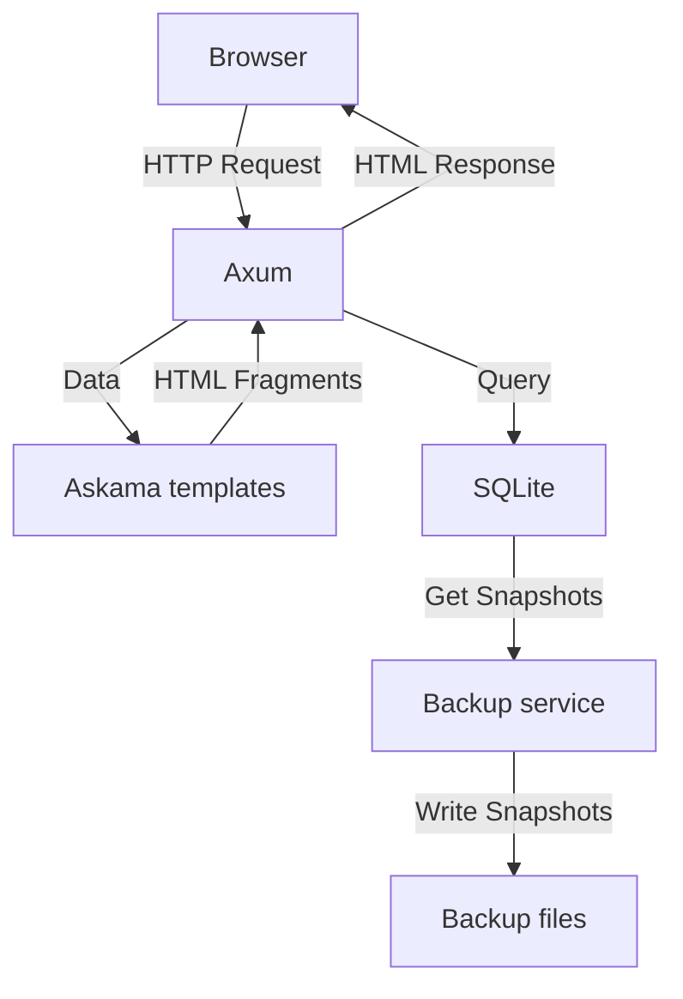

# filebase

An open-source, self-hosted document management system for organizing personal files and records.

---

## Prerequisites

- [Rust](https://www.rust-lang.org)
- [Docker](https://www.docker.com)
- [Axum](https://github.com/tokio-rs/axum)
- [Askama](https://github.com/askama-rs/askama)
- [HTMX](https://htmx.org)
- [Pico.css](https://picocss.com)
- [SQLite](https://www.sqlite.org)

---

## How it works



---

## Getting started

```bash
git clone https://github.com/justpranavrs/filebase.git
cd filebase

cp .env.example .env
docker compose up
```

Open `http://localhost:3000`.

The app is configured with these variables:

| Variable | Description | Default |
|---|---|---|
| `APP_NAME` | Application name | `filebase` |
| `TZ` | Time zone used by the containers | `Asia/Kolkata` |
| `LOG_LEVEL` | Log verbosity | `debug` |
| `SERVER_HOST` | Host the server binds to | `filebase` |
| `SERVER_PORT` | Port the server listens on | `3000` |
| `SERVER_TIMEOUT_SECONDS` | Request timeout in seconds | `30` |
| `DB_PATH` | Path to the SQLite database file | `./.data/filebase.db` |
| `DB_MAX_CONNECTIONS` | Maximum database connections in the pool | `10` |
| `DB_TIMEOUT_SECONDS` | Database timeout in seconds | `15` |
| `BACKUP_DATA_PATH` | Folder where backups are stored | `./.data/backups` |

---

## Backups

A dedicated backup service runs next to the app. It uses `alpine:3.24` as its base image and runs a shell script in a loop. On every cycle it:

1. Creates a consistent snapshot of the live database, written to a temporary file first and then renamed, so a half-written backup is never left behind.
2. Names the snapshot `filebase-<date>-<time>.db`.
3. Deletes backup files older than the configured age.

The backup service is configured with these variables:

| Variable | Description | Default |
|---|---|---|
| `DB_PATH` | SQLite database to back up | `/var/lib/filebase/data/filebase.db` |
| `DB_BACKUP_PATH` | Folder where snapshots are written | `/var/lib/filebase/backups` |
| `AGE_DAYS` | Delete backups older than this many days | `7` |
| `INTERVAL_SECONDS` | Time between backups  | `21600` |
| `TIMEOUT_MILLISECONDS` | SQLite busy timeout while taking a snapshot | `10000` |

Restore a snapshot:

```bash
docker exec -it filebase-backup cp /var/lib/filebase/backups/filebase-<date>-<time>.db /var/lib/filebase/data/filebase.db
```

---

## License

Released under the MIT License. See [LICENSE](LICENSE).