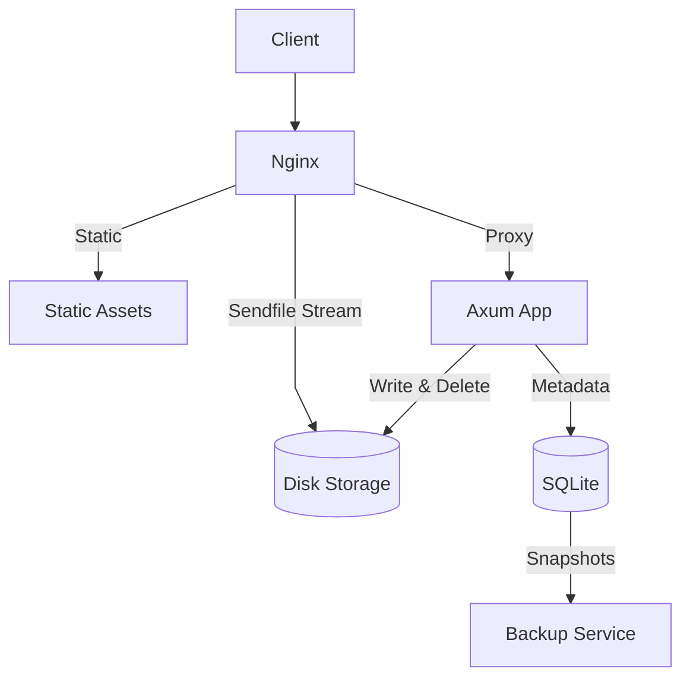

# filebase

An open-source, self-hosted document management system for personal files and records.

---

## Introduction

Filebase is a self-hosted document management system built for personal records, certificates, and important files. Beyond standard file storage, it manages document lifecycles with custom expiry alerts delivered to services like WhatsApp and Telegram before critical records expire. Designed to be lightweight and self-host friendly, Filebase runs with zero cloud dependencies, using SQLite for structured metadata and local disk storage for files.

---

## Table of Contents

- [Introduction](#introduction)
- [Core Architecture](#core-architecture)
- [Core Features](#core-features)
- [Prerequisites](#prerequisites)
- [Getting Started](#getting-started)
- [Configuration](#configuration)
- [Database Migrations](#database-migrations)
- [Nginx](#nginx)
- [Production Notes](#production-notes)
- [License](#license)

---

## Core Architecture

Filebase runs as three lightweight services (Nginx, Axum, and an automated backup worker) backed by SQLite and local disk storage:

- **Nginx**: Front-facing reverse proxy. Serves static assets directly, proxies web requests to Axum, and streams downloads straight from storage via `X-Accel-Redirect`.
- **Axum**: Rust application server handling HTTP requests, file uploads, folder operations, and server-side template rendering with Askama.
- **SQLite**: Embedded database storing folder structures, file metadata, and checksums.
- **Disk Storage**: Local directory holding uploaded files, stored by UUID object key.
- **Backup Service**: Companion container that takes periodic SQLite snapshots using `.backup` without locking active reads or writes.



---

## Core Features

### Accelerated File Streaming

Filebase delegates file downloads and inline media streaming directly to Nginx. When a user requests a file, Axum checks permissions and headers, then emits an internal redirect header (`X-Accel-Redirect`). Nginx intercepts the header and transfers the file directly from disk storage to the browser, keeping the application process free from heavy file transfer overhead.

### Checksum Verification and Caching

Files are hashed with SHA-256 during upload and stored with their metadata. When a browser requests a previously downloaded file, Filebase compares the stored checksum with the incoming `If-None-Match` header. If they match, it returns an empty `304 Not Modified`, saving disk reads and network bandwidth.

### Folder Hierarchy and Navigation

Directory trees, breadcrumb paths, and move validations run directly inside SQLite using recursive queries. This resolves ancestor chains in a single query while preventing circular moves where a folder could accidentally be moved into itself or its descendants.

### Fast Server Rendering and Dynamic UI

HTML templates compile directly into native Rust code with Askama at build time, eliminating runtime template parsing. On the frontend, HTMX swaps updated HTML fragments directly into the page during uploads, renames, and folder navigation, providing a responsive experience without a heavy single-page application framework.

---

## Prerequisites

- [Rust](https://www.rust-lang.org)
- [Docker](https://www.docker.com)
- [SQLx](https://github.com/launchbadge/sqlx)
- [Axum](https://github.com/tokio-rs/axum)
- [Askama](https://github.com/askama-rs/askama)
- [HTMX](https://htmx.org)
- [SQLite](https://www.sqlite.org)
- [Lightning CSS](https://lightningcss.dev)

---

## Getting Started

### Docker

1. Clone and configure:

   ```bash
   git clone https://github.com/justpranavrs/filebase.git
   cd filebase

   cp .env.example .env
   ```

2. Start the services:

   ```bash
   docker compose up --build
   ```

   To bundle updated CSS assets before starting containers, run:

   ```bash
   make docker-up
   # or: make css && docker compose up --build
   ```

3. Open `http://localhost` in your browser.

Database migrations run automatically on startup.

> **Note:** Migrations are compiled into the binary. Whenever you add or edit migrations, rebuild the container with `docker compose up --build`.

### Local Development

1. Clone and configure:

   ```bash
   git clone https://github.com/justpranavrs/filebase.git
   cd filebase

   cp .env.example .env
   ```

2. Build stylesheets and start the server:
   ```bash
   make css
   cargo run
   ```

To run with automatic reload during development:

```bash
cargo watch -x run
```

Database migrations run automatically on boot. To create new migration files or refresh offline query metadata, install `sqlx-cli`:

```bash
cargo install sqlx-cli --no-default-features --features sqlite,rustls,sqlx-toml
```

---

## Configuration

Filebase is configured via environment variables (loaded from `.env`):

| Variable                   | Description                                          | Default (`.env`)             |
| -------------------------- | ---------------------------------------------------- | ---------------------------- |
| `APP_NAME`                 | Project name, used for container and image naming    | `filebase`                   |
| `VERSION`                  | Application release version                          | `0.1.0`                      |
| `TZ`                       | Container time zone                                  | `Asia/Kolkata`               |
| `DATA_DIR`                 | Directory storing the active SQLite database         | `./.data`                    |
| `DATABASE_BACKUP`          | Directory where database snapshots are kept          | `./.backups`                 |
| `STORAGE_DIR`              | Directory where uploaded files are stored            | `./.storage`                 |
| `REVERSE_PROXY_PORT`       | Published host port for the bundled Nginx proxy      | `80`                         |
| `LOG_LEVEL`                | Logging verbosity (`debug`, `info`, `warn`, `error`) | `debug`                      |
| `SERVER_HOST`              | Host address Filebase binds to                       | `filebase`                   |
| `SERVER_PORT`              | Port Filebase listens on                             | `3000`                       |
| `SERVER_TIMEOUT_SECONDS`   | HTTP request timeout in seconds                      | `30`                         |
| `DATABASE_URL`             | SQLite connection string                             | `sqlite:./.data/filebase.db` |
| `DATABASE_MAX_CONNECTIONS` | Maximum connection pool size                         | `10`                         |
| `DATABASE_TIMEOUT_SECONDS` | Database lock acquire timeout in seconds             | `15`                         |

Docker notes:

- `compose.yml` mounts `${DATA_DIR:-./.data}`, `${DATABASE_BACKUP:-./.backups}`, and `${STORAGE_DIR:-./.storage}` into their respective container paths.
- The directory in `DATABASE_URL` is created automatically on startup if it doesn't already exist.

---

## Database Migrations

Migrations are embedded into the application binary and apply automatically whenever Filebase starts.

`sqlx-cli` is only needed when creating new migrations or preparing query metadata for offline builds. Make sure `DATABASE_URL` is set in your `.env` before running SQLx commands.

### Creating Migrations

```bash
sqlx migrate add <migration_name>
```

This creates a timestamped SQL file in `migrations/`. Always add a new migration instead of editing an existing one that has already been applied.

### Offline Query Metadata

Docker builds with `SQLX_OFFLINE=true`. If you modify queries or schema definitions, update the `.sqlx/` query cache:

```bash
cargo sqlx prepare
# or: make sqlx-prepare
```

---

## Nginx

Reverse proxy configs are provided in [`nginx/`](nginx/):

- [`nginx/filebase.conf`](nginx/filebase.conf): Configures caching for `/static/`, protects `/storage/` via `internal;`, and reverse proxies requests to Filebase with client IP headers.
- [`nginx/default.conf`](nginx/default.conf): Defines the `upstream filebase` block, listens on port `80`, and includes `filebase.conf`.

---

## Production Notes

Choose the setup that fits your server infrastructure:

### Option A: Single Centralized Reverse Proxy

Use this if your host already runs Nginx and you want it to serve static files and storage directly, without running the extra Nginx container in Docker.

1. Expose Filebase's port by uncommenting `ports:` under `filebase` in `compose.yml`:

   ```yaml
   ports:
     - "${SERVER_PORT:-3000}:${SERVER_PORT:-3000}"
   ```

2. Start only Filebase and the backup service:

   ```bash
   docker compose up -d filebase backups
   ```

3. Copy the configuration files to your host:

   ```bash
   sudo cp nginx/filebase.conf /etc/nginx/snippets/filebase.conf
   sudo cp nginx/default.conf /etc/nginx/conf.d/filebase.conf
   ```

4. Update the host files:
   - In `/etc/nginx/conf.d/filebase.conf`:
     - Point the upstream to the host port:
       ```nginx
       upstream filebase {
           server 127.0.0.1:3000;
       }
       ```
     - Change `server_name localhost;` to `server_name <domain>;`.
   - In `/etc/nginx/snippets/filebase.conf`:
     - Confirm `/storage/` points to your `STORAGE_DIR` (e.g. `/srv/filebase/storage/`).
     - Confirm `/static/` points to your static assets (e.g. `/srv/filebase/static/`).

5. Issue an SSL certificate:
   ```bash
   sudo certbot --nginx -d <domain>
   ```

### Option B: Chained Reverse Proxy

Use this if your host already runs a reverse proxy (such as Nginx, Caddy, or Traefik) and you want the bundled Nginx container to continue handling static assets and internal storage rules. **No files need to be copied to your host.**

1. In `.env`, set `REVERSE_PROXY_PORT` to an unused host port:

   ```env
   REVERSE_PROXY_PORT="8080"
   ```

2. In your host Nginx configuration (e.g. `/etc/nginx/conf.d/filebase.conf`), proxy traffic to that port:

   ```nginx
   server {
       listen 80;
       server_name <domain>;

       location / {
           proxy_pass http://127.0.0.1:8080;
           proxy_set_header Host $host;
           proxy_set_header X-Real-IP $remote_addr;
           proxy_set_header X-Forwarded-For $proxy_add_x_forwarded_for;
           proxy_set_header X-Forwarded-Proto $scheme;
       }
   }
   ```

3. Issue an SSL certificate:
   ```bash
   sudo certbot --nginx -d <domain>
   ```

---

## License

Released under the MIT License. See [LICENSE](LICENSE).
