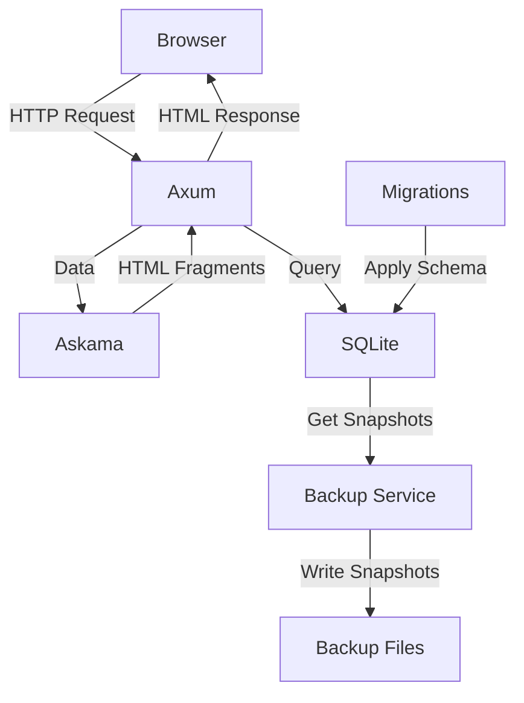

# filebase

An open-source, self-hosted document management system for organizing personal files and records.

---

## Prerequisites

- [Rust](https://www.rust-lang.org)
- [Docker](https://www.docker.com)
- [SQLx](https://github.com/launchbadge/sqlx)
- [Axum](https://github.com/tokio-rs/axum)
- [Askama](https://github.com/askama-rs/askama)
- [HTMX](https://htmx.org)
- [Pico.css](https://picocss.com)
- [SQLite](https://www.sqlite.org)

---

## How it works



The server never changes the schema on startup. Migrations run as a separate step (`--migrate-only`) before the server starts.

---

## Getting started

### Docker

```bash
git clone https://github.com/justpranavrs/filebase.git
cd filebase

cp .env.example .env

docker volume create filebase-backups
docker compose up --build
```

Open `http://localhost:3000`.

On every `docker compose up`, the `migrations` container applies pending migrations and exits. The `filebase` and `backup` services start only after it succeeds.

> **Note:** Migrations are embedded into the binary at build time. After adding or changing a migration, run `docker compose up --build`.

### Local

```bash
cargo install sqlx-cli --no-default-features --features sqlite,rustls,sqlx-toml

git clone https://github.com/justpranavrs/filebase.git
cd filebase

cp .env.example .env

cargo run -- --migrate-only   # creates the database directory and file, applies migrations
cargo run                     # starts the server
```

`sqlx-cli` is only needed for adding migrations and for generating offline query data.

---

## Configuration

The app is configured with these variables:

| Variable | Description | Default (`.env`) |
|---|---|---|
| `APP_NAME` | Application name, used for image and container names in `compose.yml` | `filebase` |
| `TZ` | Time zone used by the containers | `Asia/Kolkata` |
| `LOG_LEVEL` | Log verbosity | `debug` |
| `SERVER_HOST` | Address the server binds to | `127.0.0.1` |
| `SERVER_PORT` | Port the server listens on (host port in Docker) | `3000` |
| `SERVER_BASE_PATH` | Base path of the server | `/api` |
| `SERVER_TIMEOUT_SECONDS` | Request timeout in seconds | `30` |
| `DATABASE_URL` | SQLite database connection string | `sqlite:.data/filebase.db` |
| `DATABASE_MAX_CONNECTIONS` | Maximum database connections in the pool | `10` |
| `DATABASE_TIMEOUT_SECONDS` | Database timeout in seconds | `15` |

Docker notes:

- `compose.yml` overrides `SERVER_HOST` with `0.0.0.0`. A server bound to `127.0.0.1` inside a container is unreachable through a published port.
- `DATABASE_URL` is relative, so it resolves against the working directory (`/app` in the container). The `db-data` volume is mounted at `/app/.data`, so the database must live inside `.data`. If you change the directory in `DATABASE_URL`, change the volume mount to match.
- The URL must include a directory. A bare filename like `sqlite:filebase.db` would create the database outside the volume and lose it when the container is removed.

---

## Database Migrations

Migrations run with the app binary, not `sqlx-cli`:

```bash
# Local
cargo run -- --migrate-only

# Docker
docker compose run --rm migrations
```

`sqlx-cli` is used only to create new migration files. Ensure `DATABASE_URL` is set in your `.env` first.

### Adding Migrations

To create a new migration:

```bash
sqlx migrate add <filename>
```

This creates a new migration file inside the `migrations/` directory. Do not edit a migration after it has been applied; add a new one instead.

### Offline query data

The Docker build runs with `SQLX_OFFLINE=true`, so the committed `.sqlx/` directory must be current. After changing any `query!` macro or the schema:

```bash
cargo sqlx prepare
```

---

## Backups

A dedicated backup service runs next to the app. It uses `alpine:3.24` as its base image and runs a shell script in a loop. On every cycle it:

1. Creates a consistent snapshot of the live database, written to a temporary file first and then renamed, so a half-written backup is never left behind.
2. Names the snapshot `filebase-<date>-<time>.db`.
3. Deletes backup files older than the configured age.

The backup service is configured in `compose.yml` with these variables:

| Variable | Description | Default |
|---|---|---|
| `DB_PATH` | SQLite database to back up | `/var/lib/filebase/data/filebase.db` |
| `DB_BACKUP_PATH` | Folder where snapshots are written | `/var/lib/filebase/backups` |
| `AGE_DAYS` | Delete backups older than this many days | `7` |
| `INTERVAL_SECONDS` | Time between backups | `3600` |
| `TIMEOUT_MILLISECONDS` | SQLite busy timeout while taking a snapshot | `10000` |

Snapshots are stored in the external `filebase-backups` Docker volume, which is separate from the database volume. Both volumes live on the same host disk, so copy backups elsewhere for real protection against disk failure.

List snapshots:

```bash
docker exec filebase-backup ls -la /var/lib/filebase/backups
```

Copy snapshots to the host:

```bash
docker cp filebase-backup:/var/lib/filebase/backups ./backups-copy
```

### Restore a snapshot

Stop the server first so the live database is not overwritten while in use:

```bash
docker compose stop filebase

docker exec filebase-backup sh -c '
  cp /var/lib/filebase/backups/filebase-<date>-<time>.db /var/lib/filebase/data/filebase.db &&
  rm -f /var/lib/filebase/data/filebase.db-wal /var/lib/filebase/data/filebase.db-shm
'

docker compose start filebase
```

The `-wal` and `-shm` files are removed so SQLite does not replay stale write-ahead log data onto the restored snapshot.

---

## License

Released under the MIT License. See [LICENSE](LICENSE).