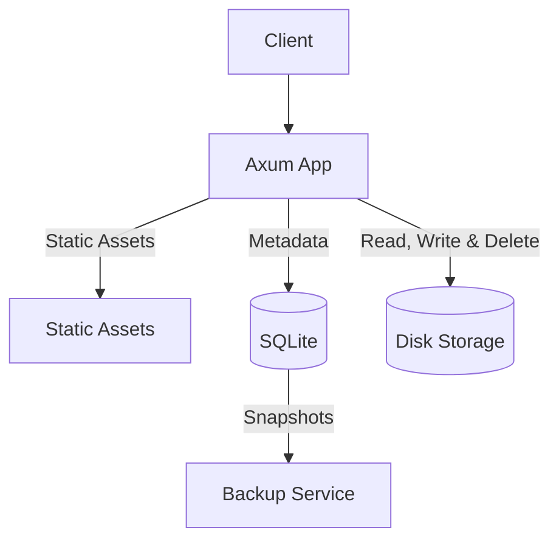

# filebase

An open-source, self-hosted document management system for personal files and records.

---

## Introduction

Filebase is a self-hosted document management system built for storing personal records, certificates, and important files. It manages document lifecycles with custom expiry alerts delivered to services like WhatsApp and Telegram before critical records expire. It runs with zero cloud dependencies, using SQLite for structured metadata and local disk storage for files.

---

## Table of Contents

- [Introduction](#introduction)
- [Core Architecture](#core-architecture)
- [Core Features](#core-features)
- [Prerequisites](#prerequisites)
- [Getting Started](#getting-started)
- [Configuration](#configuration)
- [Database Migrations](#database-migrations)
- [License](#license)

---

## Core Architecture

Filebase runs as a high-performance Rust web application paired with an automated backup worker, backed by SQLite and local disk storage:

- **Axum**: Rust application server directly serving static assets, managing file uploads and downloads, handling folder operations, and rendering server-side templates with Askama.
- **SQLite**: Embedded database storing folder structures, file metadata, and checksums.
- **Disk Storage**: Local directory holding uploaded files, stored by UUID object key.
- **Backup Service**: Companion container that takes periodic SQLite snapshots using `.backup` without locking active reads or writes.



---

## Core Features

### Checksum Verification and Caching

Files are hashed with SHA-256 during upload and stored with their metadata. When a browser requests a previously downloaded file, Filebase compares the stored checksum with the incoming `If-None-Match` header. If they match, it returns an empty `304 Not Modified`, saving disk reads and network bandwidth.

### Fast Server Rendering and Dynamic UI

HTML templates compile directly into native Rust code with Askama at build time, eliminating runtime template parsing. On the frontend, HTMX swaps updated HTML fragments directly into the page during uploads, renames, and folder navigation, providing a responsive experience without a heavy single-page application framework.

---

## Prerequisites

- [Rust](https://www.rust-lang.org)
- [Docker](https://www.docker.com)
- [Docker Scout](https://docs.docker.com/scout/install/)
- [SQLx](https://github.com/launchbadge/sqlx)
- [Axum](https://github.com/tokio-rs/axum)
- [Askama](https://github.com/askama-rs/askama)
- [HTMX](https://htmx.org)
- [SQLite](https://www.sqlite.org)
- [Lightning CSS](https://lightningcss.dev)

---

## Getting Started

### Docker

1. Clone and configure:

   ```bash
   git clone https://github.com/justpranavrs/filebase.git
   cd filebase

   cp .env.example .env
   ```

2. Start the services:

   ```bash
   docker compose up --build
   ```

   To bundle updated CSS assets before starting containers, run:

   ```bash
   make docker-up
   # or: make css && docker compose up --build
   ```

3. Open `http://localhost:3000` in your browser.

Database migrations run automatically on startup.

> **Note:** Migrations are compiled into the binary. Whenever you add or edit migrations, rebuild the container with `docker compose up --build`.

### Vulnerability Scanning

Filebase uses Docker Scout to scan container images for known vulnerabilities and base image optimizations. After installing [Docker Scout](https://docs.docker.com/scout/install/), run:

```bash
./docker/scout.sh
# or: make docker-scout
```

This runs quickview and recommendations, filters for fixable Critical and High CVEs, and exports a SARIF report to `docker/scout.sarif`.

### Local Development

1. Clone and configure:

   ```bash
   git clone https://github.com/justpranavrs/filebase.git
   cd filebase

   cp .env.example .env
   ```

2. Build stylesheets and start the server:
   ```bash
   make css
   cargo run
   ```

Database migrations run automatically on boot. To create new migration files or refresh offline query metadata, install `sqlx-cli`:

```bash
cargo install sqlx-cli --no-default-features --features sqlite,rustls,sqlx-toml
```

---

## Configuration

Filebase is configured via environment variables (loaded from `.env`):

| Variable                   | Description                                          | Default (`.env`)             |
| -------------------------- | ---------------------------------------------------- | ---------------------------- |
| `IMAGE_NAME`               | Docker image repository name                         | `filebase`                   |
| `VERSION`                  | Application release version                          | `0.1.0`                      |
| `TZ`                       | Container time zone                                  | `Asia/Kolkata`               |
| `DATA_DIR`                 | Directory storing the active SQLite database         | `./.data`                    |
| `DATABASE_BACKUP`          | Directory where database snapshots are kept          | `./.backups`                 |
| `STORAGE_DIR`              | Directory where uploaded files are stored            | `./.storage`                 |
| `LOG_LEVEL`                | Logging verbosity (`debug`, `info`, `warn`, `error`) | `debug`                      |
| `SERVER_HOST`              | Host address Filebase binds to                       | `filebase`                   |
| `SERVER_PORT`              | Port Filebase listens on                             | `3000`                       |
| `SERVER_TIMEOUT_SECONDS`   | HTTP request timeout in seconds                      | `30`                         |
| `DATABASE_URL`             | SQLite connection string                             | `sqlite:./.data/filebase.db` |
| `DATABASE_MAX_CONNECTIONS` | Maximum connection pool size                         | `10`                         |
| `DATABASE_TIMEOUT_SECONDS` | Database lock acquire timeout in seconds             | `15`                         |

Docker notes:

- `compose.yml` mounts `${DATA_DIR:-./.data}`, `${DATABASE_BACKUP:-./.backups}`, and `${STORAGE_DIR:-./.storage}` into their respective container paths.
- The directory in `DATABASE_URL` is created automatically on startup if it doesn't already exist.

---

## Database Migrations

Migrations are embedded into the application binary and apply automatically whenever Filebase starts.

`sqlx-cli` is only needed when creating new migrations or preparing query metadata for offline builds. Make sure `DATABASE_URL` is set in your `.env` before running SQLx commands.

### Creating Migrations

```bash
sqlx migrate add <migration_name>
```

This creates a timestamped SQL file in `migrations/`. Always add a new migration instead of editing an existing one that has already been applied.

### Offline Query Metadata

Docker builds with `SQLX_OFFLINE=true`. If you modify queries or schema definitions, update the `.sqlx/` query cache:

```bash
cargo sqlx prepare
# or: make sqlx-prepare
```

---

## License

Released under the MIT License. See [LICENSE](LICENSE).
