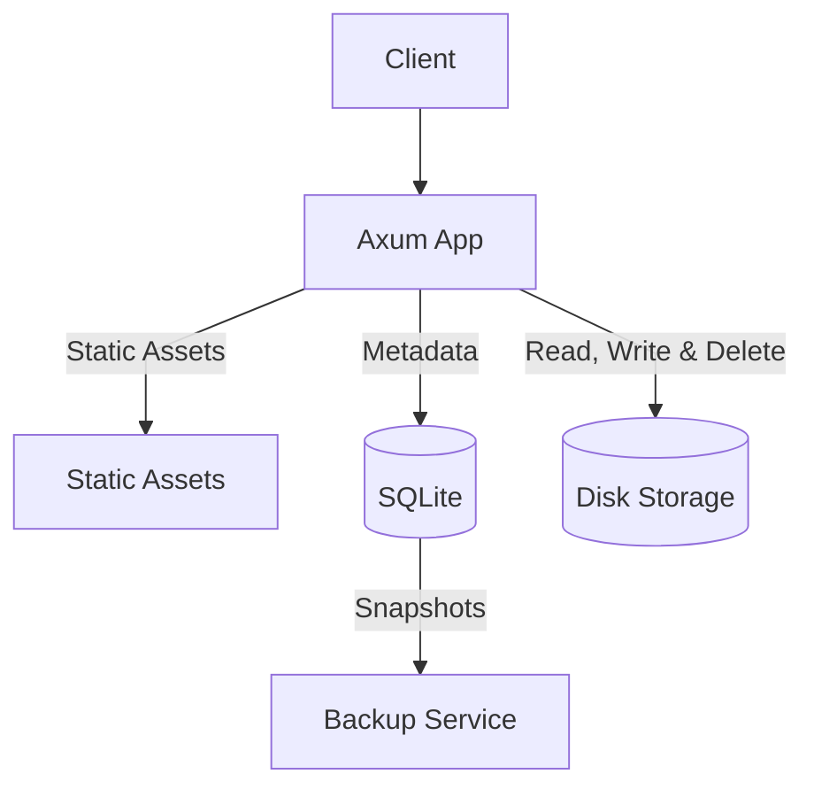

# filebase

An open-source, self-hosted document management system for personal files and records.

---

## Introduction

<p>
  
</p>

Filebase is an open-source, self-hosted document management system built for storing personal records, certificates, and files locally. It operates with zero cloud dependencies, using SQLite for structured metadata and local disk storage for document files.

The web interface is server-rendered using Askama templates and HTMX, providing fast in-page updates without client-side single-page framework overhead.

---

## Table of Contents

- [Introduction](#introduction)
- [Core Architecture](#core-architecture)
- [Core Features](#core-features)
- [Prerequisites](#prerequisites)
- [Getting Started](#getting-started)
- [Configuration](#configuration)
- [Database Migrations](#database-migrations)
- [CI/CD](#cicd)
- [License](#license)

---

## Core Architecture

Filebase runs as a high-performance Rust web application paired with an automated backup worker, backed by SQLite and local disk storage:

- **Axum**: Application server handling file operations, folder navigation, static asset delivery, and template rendering.
- **SQLite**: Embedded database storing folder structures, document metadata, and SHA-256 checksums in WAL mode.
- **Disk Storage**: Local filesystem directory storing uploaded documents by UUID object key.
- **Backup Companion**: Companion container that creates periodic non-blocking SQLite snapshots using `VACUUM INTO` and purges older archives based on retention limits.



---

## Core Features

### Checksum Verification and Caching

Files are hashed with SHA-256 upon upload. Stored checksums serve as ETags on subsequent requests: when a browser sends an `If-None-Match` header matching the checksum, Filebase returns an empty `304 Not Modified`, avoiding redundant disk reads and data transfers.

### Fast Server Rendering and Dynamic UI

Templates compile directly into native Rust code with Askama at build time, eliminating runtime template parsing. HTMX swaps updated HTML fragments directly into the DOM during uploads, renames, and folder navigation, providing fast in-page updates without client-side single-page framework overhead.

---

## Prerequisites

- [Rust](https://www.rust-lang.org)
- [Docker](https://www.docker.com)
- [Docker Scout](https://docs.docker.com/scout/install/)
- [SQLx](https://github.com/launchbadge/sqlx)
- [Axum](https://github.com/tokio-rs/axum)
- [Askama](https://github.com/askama-rs/askama)
- [HTMX](https://htmx.org)
- [SQLite](https://www.sqlite.org)
- [Lightning CSS](https://lightningcss.dev)

---

## Getting Started

### Quick Start

Run Filebase using the official pre-built Docker image:

```bash
mkdir -p data storage

docker run -d \
  --name filebase \
  -p 3000:3000 \
  --user "$(id -u):$(id -g)" \
  -v ./data:/var/lib/filebase/data \
  -v ./storage:/var/lib/filebase/storage \
  --restart unless-stopped \
  justpranavrs/filebase:0.1.0-alpha
```

Open `http://localhost:3000` in your browser. Database migrations run automatically on startup.

### Docker Compose

1. Clone and configure:

   ```bash
   git clone https://github.com/justpranavrs/filebase.git
   cd filebase

   cp .env.example .env
   ```

2. Start the services:

   ```bash
   docker compose up --build
   ```

   To bundle updated CSS assets before starting containers, run:

   ```bash
   make docker-up
   # or: make css && docker compose up --build
   ```

3. Open `http://localhost:3000` in your browser.

Database migrations run automatically on startup.

> **Note:** Migrations are compiled into the binary. When adding or editing migrations, rebuild the container with `docker compose up --build`.

### Vulnerability Scanning

Filebase uses Docker Scout to scan container images for known vulnerabilities and base image optimizations. After installing [Docker Scout](https://docs.docker.com/scout/install/), run:

```bash
./docker/scout.sh
# or: make docker-scout
```

This runs quickview and recommendations, filters for fixable Critical and High CVEs, and exports a SARIF report to `docker/scout.sarif`.

### Local Development

1. Clone and configure:

   ```bash
   git clone https://github.com/justpranavrs/filebase.git
   cd filebase

   cp .env.example .env
   ```

2. Build stylesheets and start the server:

   ```bash
   make css
   cargo run
   ```

Database migrations run automatically on startup. To create new migration files or refresh offline query metadata, install `sqlx-cli`:

```bash
cargo install sqlx-cli --no-default-features --features sqlite,rustls,sqlx-toml
```

---

## Configuration

Filebase is configured via environment variables (loaded from `.env`):

| Variable                   | Description                                          | Default (`.env`)             |
| -------------------------- | ---------------------------------------------------- | ---------------------------- |
| `IMAGE_NAME`               | Docker image repository name                         | `filebase`                   |
| `VERSION`                  | Application release version                          | `0.1.0`                      |
| `TZ`                       | Container time zone                                  | `Asia/Kolkata`               |
| `DATA_DIR`                 | Directory storing the active SQLite database         | `./.data`                    |
| `DATABASE_BACKUP`          | Directory where database snapshots are kept          | `./.backups`                 |
| `STORAGE_DIR`              | Directory where uploaded files are stored            | `./.storage`                 |
| `LOG_LEVEL`                | Logging verbosity (`debug`, `info`, `warn`, `error`) | `debug`                      |
| `SERVER_HOST`              | Host address Filebase binds to                       | `127.0.0.1`                  |
| `SERVER_PORT`              | Port Filebase listens on                             | `3000`                       |
| `SERVER_TIMEOUT_SECONDS`   | HTTP request timeout in seconds                      | `30`                         |
| `DATABASE_URL`             | SQLite connection string                             | `sqlite:./.data/filebase.db` |
| `DATABASE_MAX_CONNECTIONS` | Maximum connection pool size                         | `10`                         |
| `DATABASE_TIMEOUT_SECONDS` | Database lock acquire timeout in seconds             | `15`                         |

Docker notes:

- `compose.yml` mounts `${DATA_DIR:-./.data}`, `${DATABASE_BACKUP:-./.backups}`, and `${STORAGE_DIR:-./.storage}` into their respective container paths.
- The directory in `DATABASE_URL` is created automatically on startup if it does not already exist.
- The official container image runs as an unprivileged user (`nonroot`, UID `65532`). When using host volume mounts on Linux, create directories beforehand or pass `--user "$(id -u):$(id -g)"`.

---

## Database Migrations

Migrations are embedded into the application binary and execute automatically on startup.

`sqlx-cli` is only required when creating new migrations or preparing query metadata for offline builds. Ensure `DATABASE_URL` is set in `.env` before running SQLx commands.

### Creating Migrations

```bash
sqlx migrate add <migration_name>
```

This creates a timestamped SQL file in `migrations/`. Always add a new migration rather than modifying migrations that have already run.

### Offline Query Metadata

Docker builds with `SQLX_OFFLINE=true`. When modifying queries or schema definitions, update the `.sqlx/` query cache:

```bash
cargo sqlx prepare
# or: make sqlx-prepare
```

---

## CI/CD

If you fork this repository to build and release your own container images via GitHub Actions (`.github/workflows/release.yml`), configure the following credentials under **Settings → Secrets and variables → Actions**:

| Name | Type | Description |
| :--- | :--- | :--- |
| `DOCKERHUB_USERNAME` | **Repository Variable** | Your Docker Hub account or organization username |
| `DOCKERHUB_TOKEN` | **Repository Secret** | Docker Hub Personal Access Token (PAT) with Read & Write permissions |

Without these credentials, the `Build, Scan, and Push` release workflow will fail to authenticate with Docker Hub when `v*` tags are pushed.

---

## License

Released under the MIT License. See [LICENSE](LICENSE).
