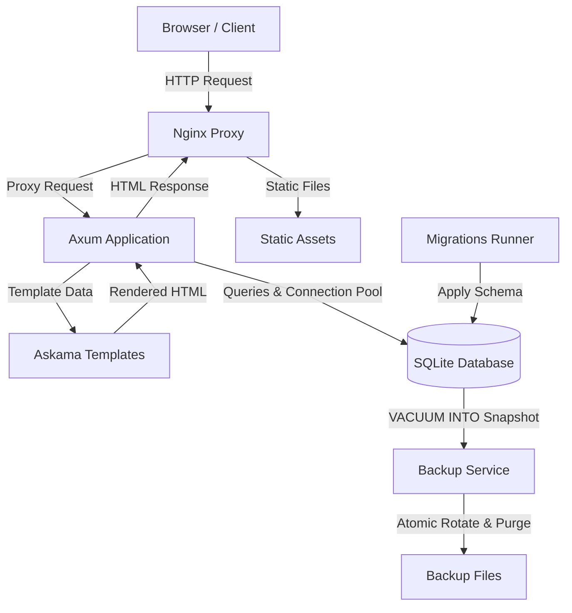

# filebase

An open-source, self-hosted document management system for personal files and records.

---

## Prerequisites

- [Rust](https://www.rust-lang.org)
- [Docker](https://www.docker.com)
- [SQLx](https://github.com/launchbadge/sqlx)
- [Axum](https://github.com/tokio-rs/axum)
- [Askama](https://github.com/askama-rs/askama)
- [HTMX](https://htmx.org)
- [SQLite](https://www.sqlite.org)
- [Lightning CSS](https://lightningcss.dev)

---

## How it works



Database migrations are embedded directly into the binary and run automatically when Filebase boots.

---

## Getting Started

### Docker

Running Docker Compose requires `lightningcss` to bundle CSS assets before building the containers:

```bash
npm install -g lightningcss
```

1. Clone and configure:
   ```bash
   git clone https://github.com/justpranavrs/filebase.git
   cd filebase

   cp .env.example .env
   ```

2. Start the services (or run `make docker-up`):
   ```bash
   docker compose up --build
   ```

Visit `http://localhost`.

On startup, Filebase automatically applies any pending database migrations before serving traffic.

> **Note:** Migrations are baked into the binary at build time. Whenever you add or edit migrations, rebuild the container with `docker compose up --build`.

### Local

```bash
git clone https://github.com/justpranavrs/filebase.git
cd filebase

cp .env.example .env

cargo run
```

Migrations run automatically on boot. To create new migration files or prepare offline query cache data, install `sqlx-cli`:

```bash
cargo install sqlx-cli --no-default-features --features sqlite,rustls,sqlx-toml
```

---

## Configuration

Filebase is configured via environment variables (loaded from `.env`):

| Variable | Description | Default (`.env`) |
|---|---|---|
| `APP_NAME` | Project name, used for container and image naming | `filebase` |
| `TZ` | Time zone used by containers | `Asia/Kolkata` |
| `DATA_DIR` | Directory storing the active SQLite database | `./.data` |
| `DATABASE_BACKUP` | Directory where database snapshots are kept | `./.backups` |
| `STORAGE_DIR` | Directory where uploaded files are stored | `./storage` |
| `REVERSE_PROXY_PORT` | Published host port for the bundled Nginx proxy | `80` |
| `LOG_LEVEL` | Logging verbosity (`debug`, `info`, `warn`, `error`) | `debug` |
| `SERVER_HOST` | Address Filebase binds to | `filebase` |
| `SERVER_PORT` | Port Filebase listens on | `3000` |
| `SERVER_TIMEOUT_SECONDS` | HTTP request timeout in seconds | `30` |
| `DATABASE_URL` | SQLite connection string | `sqlite:./.data/filebase.db` |
| `DATABASE_MAX_CONNECTIONS` | Maximum connection pool size | `10` |
| `DATABASE_TIMEOUT_SECONDS` | Database lock acquire timeout in seconds | `15` |

Docker notes:
- `compose.yml` mounts `${DATA_DIR:-./.data}`, `${DATABASE_BACKUP:-./backups}`, and `${STORAGE_DIR:-./storage}` into their respective container paths.
- The directory in `DATABASE_URL` is created automatically on startup if it doesn't already exist.

---

## Database Migrations

Migrations are embedded into the binary and run automatically whenever the application starts.

`sqlx-cli` is only needed when creating new migrations or refreshing offline query metadata. Ensure `DATABASE_URL` is set in your `.env` before running SQLx commands.

### Adding Migrations

Generate a new migration file:

```bash
sqlx migrate add <migration_name>
```

This creates a new timestamped SQL file in `migrations/`. Always add a new migration instead of modifying an existing one that has already been applied.

### Offline Query Metadata

Docker builds with `SQLX_OFFLINE=true`. If you modify any SQL queries or table schemas, refresh the `.sqlx/` cache and commit it:

```bash
cargo sqlx prepare
```

---

## Nginx

Reverse proxy configs are provided in [`nginx/`](nginx/):

- [`nginx/filebase.conf`](nginx/filebase.conf): Configures caching for `/static/`, protects `/storage/` via `internal;`, and reverse proxies requests to Filebase with client IP headers.
- [`nginx/default.conf`](nginx/default.conf): Defines the `upstream filebase` block, listens on port `80`, and includes `filebase.conf`.

---

## Production Notes

Choose the setup that fits your server infrastructure:

### Option A: Single Centralized Reverse Proxy

Use this if you want your host's Nginx to serve static files and protect storage directly without running the extra Nginx container in Docker.

1. Do not start the `nginx` container (run `docker compose up -d filebase backups` or remove the `nginx` service from `compose.yml`).

2. Expose Filebase's port by uncommenting `ports:` under `filebase` in `compose.yml`:
   ```yaml
   ports:
     - "${SERVER_PORT:-3000}:${SERVER_PORT:-3000}"
   ```

3. Copy the configuration files to your host:
   ```bash
   sudo cp nginx/filebase.conf /etc/nginx/snippets/filebase.conf
   sudo cp nginx/default.conf /etc/nginx/conf.d/filebase.conf
   ```

4. Update the host files:
   - In `/etc/nginx/conf.d/filebase.conf`:
     - Point the upstream to the host port:
       ```nginx
       upstream filebase {
           server 127.0.0.1:3000;
       }
       ```
     - Change `server_name localhost;` to `server_name <domain>;`.
   - In `/etc/nginx/snippets/filebase.conf`:
     - Confirm `/storage/` points to your `STORAGE_DIR` (e.g., `/srv/filebase/storage/`).
     - Confirm `/static/` points to your static assets (e.g., `/srv/filebase/static/`).

5. Issue an SSL certificate:
   ```bash
   sudo certbot --nginx -d <domain>
   ```

### Option B: Chained Reverse Proxy

Use this if you already run a centralized host proxy (such as Nginx, Caddy, or Traefik) and want the bundled Nginx container to continue handling static assets and internal storage rules. **No files need to be copied to your host.**

1. In `.env`, set `REVERSE_PROXY_PORT` to an unused host port (e.g., `8080`):
   ```env
   REVERSE_PROXY_PORT="8080"
   ```

2. In your host Nginx configuration (e.g. `/etc/nginx/conf.d/filebase.conf`), proxy traffic to that port:
   ```nginx
   server {
       listen 80;
       server_name <domain>;

       location / {
           proxy_pass http://127.0.0.1:8080;
           proxy_set_header Host $host;
           proxy_set_header X-Real-IP $remote_addr;
           proxy_set_header X-Forwarded-For $proxy_add_x_forwarded_for;
           proxy_set_header X-Forwarded-Proto $scheme;
       }
   }
   ```

3. Issue an SSL certificate:
   ```bash
   sudo certbot --nginx -d <domain>
   ```

---

## License

Released under the MIT License. See [LICENSE](LICENSE).